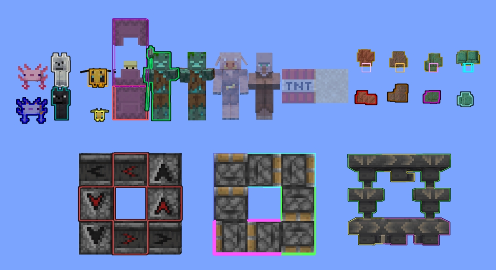
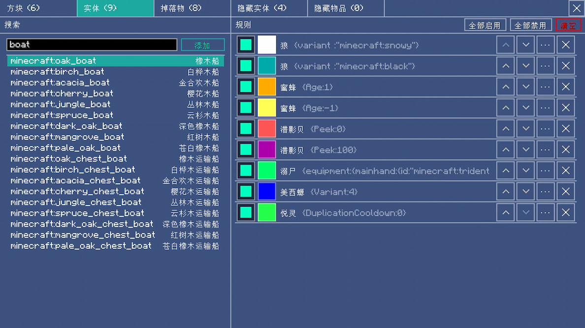

# Precise Glower 精准高亮

一个Minecraft Fabric 客户端 mod，为方块、实体和掉落物绘制高亮线框或描边，支持众多详细配置。

## 使用

默认按 **`G`** 键打开界面。

## 功能

- 方块高亮：高亮指定方块，支持ID、tag、方块状态过滤，自动分配初始颜色，线框忽略相邻面，支持类似实体的描边效果
- 实体高亮：高亮指定实体，支持按ID、nbt过滤，支持碰撞箱高亮
- 物品高亮：高亮指定掉落物，支持按ID、物品数量过滤
- 实体隐藏：调整指定生物透明度，支持忽略指定实体交互，支持隐藏指定掉落物
- 搜索：支持按ID或名称搜索
- 补全：ID、状态、NBT支持代码提示补全
- 模式：支持调整线框颜色、粗细，支持调整高亮范围
- 通配符：仅通过方块状态、实体NBT匹配
